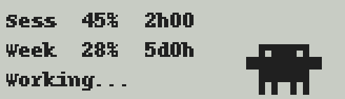
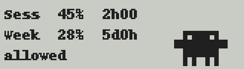
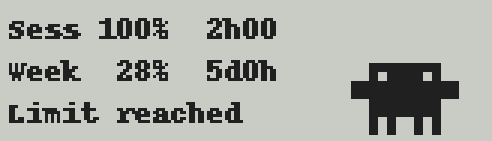

# Claude usage on the Logitech G510 LCD

Shows your Claude Code session (5h) and weekly (7d) usage on the built-in
monochrome LCD of a Logitech G510 keyboard, and refreshes it every minute.
With the optional hooks, the last line shows what Claude Code is doing
(`Needs you!`, `Working...`, `Your turn`), and with Anthropic's official
Clawd art, Clawd acts it out next to the numbers:



Without the art it is plain text, drawn by the LCD SDK's own font:

```
Claude Usage
Sess  45%  rst 2h00
Week  28%  rst 5d0h
allowed
```

Inspired by [Clawdmeter](https://github.com/HermannBjorgvin/Clawdmeter), an
ESP32 desk display for the same data. This project is independent: it shares
no code with Clawdmeter and only relies on the publicly observable
`anthropic-ratelimit-unified-*` response headers.

## How it works

1. Reads the Claude Code OAuth token from `~/.claude/.credentials.json`
   (or `$CLAUDE_CONFIG_DIR`). It never refreshes the token itself; Claude Code
   owns that. When the API answers 401 (the token went stale because Claude
   Code has not run for a while), it runs the Claude CLI once
   (`claude -p` with Haiku, no tools, no hooks), which renews the token, and
   polls again. At most one attempt per 15 minutes; `G510_NO_CLI_RENEW=1`
   turns it off.
2. Sends a 1-token Haiku request and reads utilization from the response
   headers. A 429 (limit used up) still carries them and shows as
   `Limit reached`.
3. Draws on the LCD through the Logitech LCD SDK (`LogitechLcd.dll`, part of
   Logitech Gaming Software): 4 text lines, or with the Clawd art a full
   160x43 bitmap, redrawn at the animation's frame rate.

## Claude Code state (optional)

```powershell
g510\.venv\Scripts\python g510\claude_state.py --install     # --uninstall removes it
```

This adds hook entries to `~/.claude/settings.json` (only entries running
`claude_state.py --hook` are ever touched). Each hook event writes a small
file per session to `~/.config/claude-g510/sessions`; the daemon reads them
every second. A session waiting on a permission prompt or question beats one
that is working, which beats one that just finished.

## Clawd animation (optional)

With Anthropic's official Clawd art available, the LCD switches to a
graphics mode: usage on the left, Clawd on the right, animated by Claude
Code's state.

| State | LCD | Official file |
| --- | --- | --- |
| idle |  | `Clawd-Still.png` |
| `Working...` |  | `Clawd-CrabWalking.gif` |
| `Needs you!` |  | `Clawd-Pointing.gif` |
| `Your turn` |  | `Clawd-JumpingHappy.gif` |
| limit reached |  | `Clawd-Still.png` |

The official files draw Clawd on a 55x37 cell stage in 2x2-cell blocks; the
daemon takes one sample per cell, keeps what is opaque and not dark (so the
eyes stay holes) and scales by 1.5, which keeps every block a crisp 3x3 px.

The art is Anthropic's, and the source files are **not** part of this
repository. The daemon reads them at runtime from `%G510_CLAWD_DIR%`, or from
a Clawdmeter checkout next to `g510` (`Clawdmeter\research\clawd-official`,
ignored by git). The files are served by claude.ai under
`/images/clawd/core/`. Without them (or without Pillow) the daemon keeps the
plain text display.

The pictures above are rendered by the daemon's own code:
`g510\.venv\Scripts\python g510\preview.py` writes them to `docs/`.

## Requirements

- Windows, Python 3.11+
- **Logitech Gaming Software (LGS)** installed and running. G HUB does not
  support the G510.
- Claude Code with an active subscription login

## Setup

```powershell
python -m venv g510\.venv
g510\.venv\Scripts\pip install -r g510\requirements.txt
g510\.venv\Scripts\python g510\daemon.py
```

Autostart at login (per user, no admin needed; `-Remove` undoes it):

```powershell
powershell -ExecutionPolicy Bypass -File g510\autostart.ps1
```

Logs: `%LOCALAPPDATA%\ClaudeG510\g510.log`

## Layout

| File | Purpose |
| --- | --- |
| `g510/lcd_sdk.py` | ctypes bindings for `LogitechLcd.dll` (finds it under the LGS install dir; LGS does not put it on `PATH`) |
| `g510/claude_api.py` | token lookup + rate-limit polling |
| `g510/cli_renew.py` | lets the Claude CLI renew an expired token |
| `g510/claude_state.py` | Claude Code hooks: hook handler, state folding, `--install` |
| `g510/clawd_art.py` | official Clawd art to 1-bit LCD frames, screen composition |
| `g510/render.py` | usage payload to LCD text lines (pure function) |
| `g510/preview.py` | renders the README pictures in `docs/` |
| `g510/daemon.py` | poll loop |
| `g510/autostart.ps1` | login autostart via `HKCU\...\Run` |

## Troubleshooting

- `LogitechLcd.dll could not be loaded`: LGS is not installed, or the DLL
  bitness does not match your Python (both `x64` and `x86` builds exist under
  `C:\Program Files\Logitech Gaming Software\SDK\LCD\`; the matching one is
  picked automatically).
- LCD shows "No data / run claude login": token missing, or expired and the
  CLI renewal did not help (see the log). `claude --version` does not refresh
  it; run `claude login`.
- Autostart does nothing at login although `autostart.ps1` reported success:
  it was run from a Claude desktop app session. The desktop app is an MSIX
  package, and everything it starts gets its `HKCU` and `AppData` writes
  redirected into the package's private copy. Run the script from a normal
  PowerShell window.

## Limitations

- Not tested on enterprise/overage accounts (the headers differ; the display
  keeps its last values in that case).
- Not affiliated with Anthropic or Logitech.

## License

The code is MIT, see [LICENSE](LICENSE). The pictures in `docs/` show
Anthropic's Clawd and are not covered by that license; Clawd is Anthropic's
copyrighted mascot.
